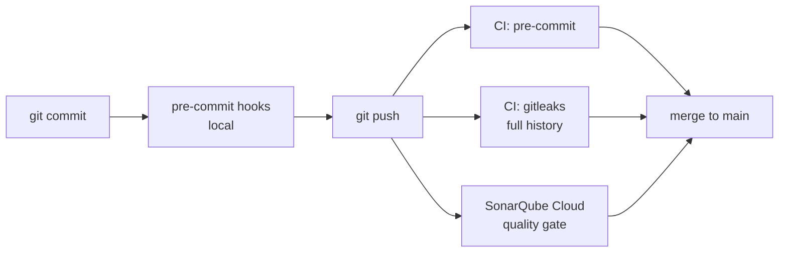

# Shift-Left Security

## Why?

In a collaborative environment, everyone needs to be on the same page. Linting makes code readable and everyone's life easier. Looking for known issues makes everyone a better coder, and can also meet the needs of security teams and auditors, since we're checking for the known bad things. A spell checker against `*.md` saves some embarrassment.

At this point, it helps prevent a lot of headaches.

## How it flows

## Getting Started

1. [Python venv](./PYTHON_VENV_README.md): you should be comfortable creating Python virtual environments.
2. In your new venv, install the tools with either:
   - `make install-tools` from this directory (also installs the pre-commit hook), or
   - `python -m pip install --only-binary :all: -r requirements-tools.txt` if you'd rather skip `make`
3. If you used pip directly: [install the pre-commit hook](./PRE_COMMIT_README.md) so checks run on every `git commit`.

## What runs on commit

| Hook | Why |
|---|---|
| ruff-check, ruff-format | Lint and format Python consistently |
| bandit | Flag common Python security issues (`useful_python/`) |
| gitleaks | Block secrets in staged changes before they're ever committed |
| shellcheck | Catch shell script bugs |
| codespell | Typos in Markdown (`*.md`) |
| pre-commit-hooks | Whitespace, YAML/TOML syntax, merge markers, private keys, large files, shebangs |

## What runs in CI (GitHub Actions, on PRs and pushes to main)

| Workflow | Why |
|---|---|
| `pre-commit.yaml` | Same hooks on every push/PR (except gitleaks, see next row), so nothing depends on someone remembering to install them |
| `gitleaks.yaml` | Scans **git history**, not just staged files. The pre-commit hook only checks staged changes, which don't exist in CI, so this replaces it there. A deleted secret still lives in old commits |
| SonarQube Cloud | Static analysis for bugs, vulnerabilities, and code smells, with a quality gate on new code |

## SonarQube Cloud

[SonarQube Cloud](https://sonarcloud.io) is static analysis: it reads the code without running it and looks for:

- **Bugs**: code that will likely break at runtime
- **Vulnerabilities and security hotspots**: injection, weak crypto, hardcoded credentials, risky patterns worth a human look
- **Code smells**: maintainability problems that make code harder to change
- **Duplication**: copy-pasted blocks

It also flags issues in the CI setup itself; the pinned SHAs and `--only-binary` in this repo came out of Sonar findings.

### Setup

1. Sign in at [sonarcloud.io](https://sonarcloud.io) with **GitHub**. That creates the account and links your GitHub organization. Free for public repos.
2. **Analyze new project** → pick the repo → import.
3. Leave **Automatic Analysis** on. Sonar scans every push and PR itself, with no workflow file or token.

To get test coverage in Sonar later, switch to CI-based analysis: turn off Automatic Analysis, add a `SONAR_TOKEN` repo secret, a `sonar-project.properties` file, and a `sonarqube-scan-action` workflow step.

### Quality gate

Sonar judges **new code** only, not the whole history. A PR fails the gate if the code it adds brings new bugs or vulnerabilities, unreviewed hotspots, or too much duplication. Old issues don't block new work, but nothing new gets worse.

### Where to see results

- **On the PR**: a SonarQube check, plus a summary comment
- **Dashboard**: [sonarcloud.io](https://sonarcloud.io) → this project → pick the branch or PR

Automatic analysis runs on Sonar's side, so it shows up as a PR check but not in the GitHub **Actions** tab.

### Locally (optional)

The [SonarQube CLI](https://docs.sonarsource.com/sonarqube-cli/) (`brew install sonarqube-cli`) can add a pre-commit hook that blocks secrets before commit (`sonar integrate git --hook pre-commit --local`). This repo already uses gitleaks for that, so it's optional.

## Supply-chain hardening

The pipeline itself is attack surface, so it's locked down too:

- **Actions pinned to full commit SHAs** (`@<sha> # v4.4.0`). Tags can be moved; commits can't. See the 2025 `tj-actions/changed-files` compromise.
- **Least-privilege tokens**: `permissions: contents: read`, and `persist-credentials: false` so the token isn't left in `.git/config`.
- **No stored secrets for gitleaks**: it uses GitHub's short-lived, auto-generated `GITHUB_TOKEN`.
- **Wheel-only installs** (`--only-binary :all:`) in CI and the Makefile, so no `setup.py` runs at install time. pre-commit in CI is also pinned to an exact version.

## CI caching

pre-commit builds an isolated environment for each hook on first run, which is slow. The workflow caches `~/.cache/pre-commit` so later runs reuse them.

The cache key is made of three parts. If any of them changes, the cache is rebuilt instead of reused:

| Key part | Why it's in the key |
|---|---|
| `runner.os` | Environments built on Linux don't work on macOS or Windows |
| Python version (exact, e.g. `3.13.1`) | Hook environments are tied to the interpreter they were built with; a Python update would otherwise restore broken environments |
| Hash of `.pre-commit-config.yaml` | Changing a hook or bumping a `rev` gets fresh environments |

## Further reading

- [What is shift left testing?](https://github.com/resources/articles/security/what-is-shift-left-testing) (GitHub): why earlier checks cost less and ship faster
- [What is DevSecOps?](https://github.com/resources/articles/what-is-devsecops) (GitHub): the broader practice this fits into
- [Supply chain compromise of tj-actions/changed-files](https://www.cisa.gov/news-events/alerts/2025/03/18/supply-chain-compromise-third-party-github-action-cve-2025-30066) (CISA): why actions are pinned to SHAs
- [Use "pip install" safely](https://www.b-list.org/weblog/2023/dec/07/pip-install-safely/) (James Bennett): why `--only-binary :all:` and exact pins matter
- [Secure installs](https://pip.pypa.io/en/stable/topics/secure-installs/) (pip docs): pip's own guidance on hardening installs
- [actions/cache](https://github.com/actions/cache) (GitHub): how cache keys and restores work
